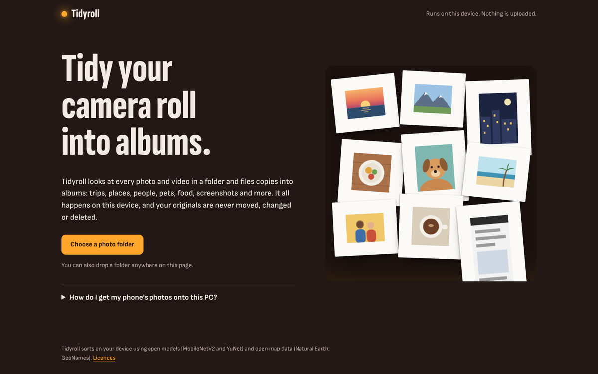
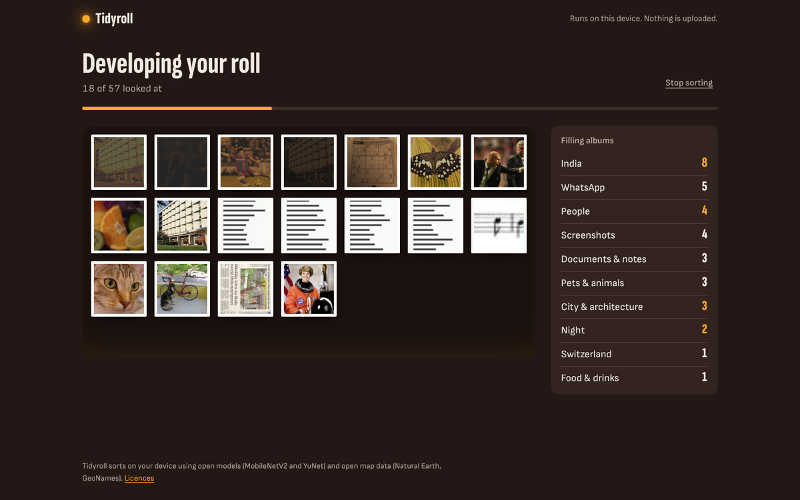
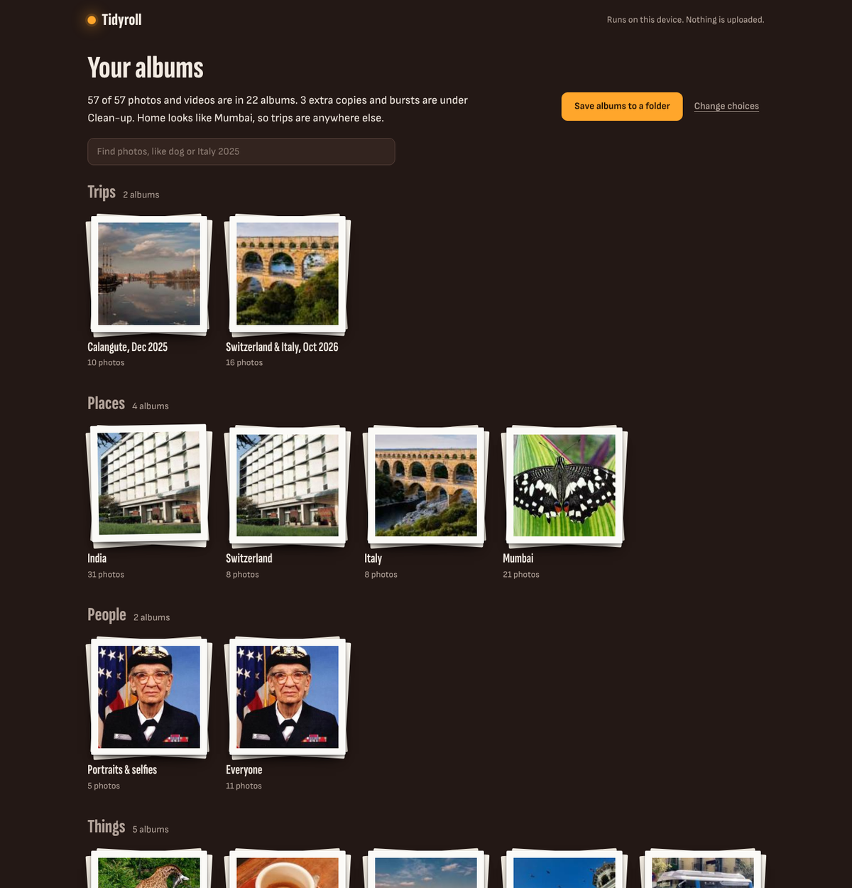
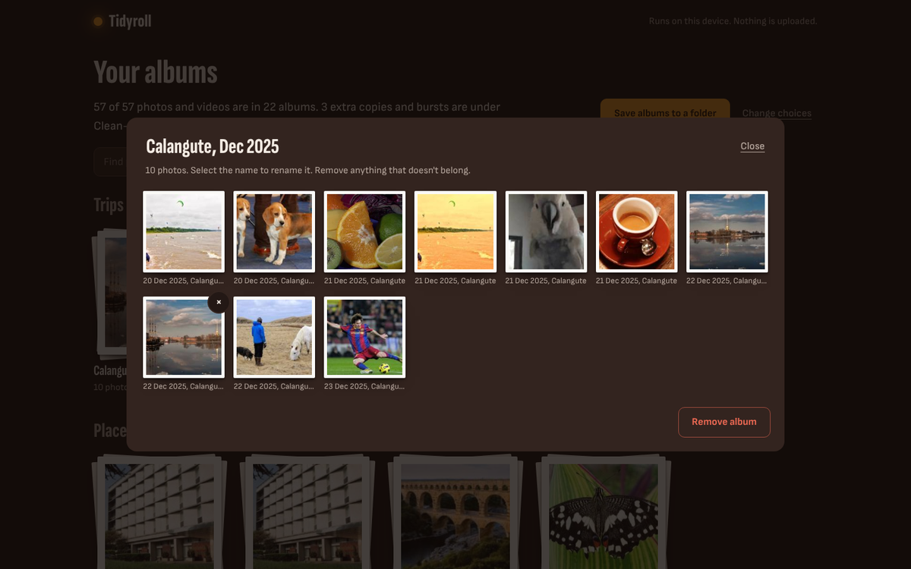
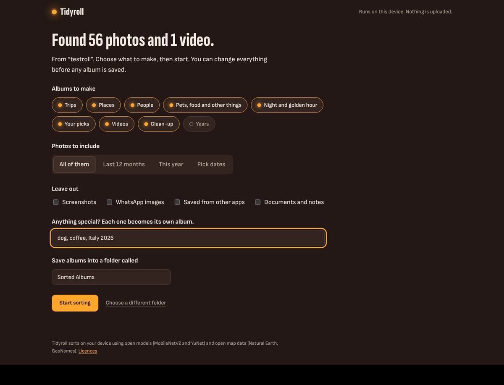
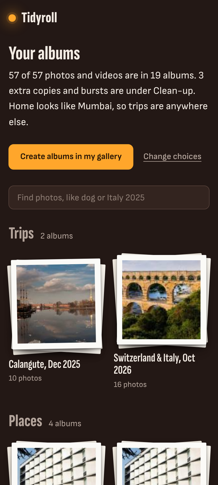
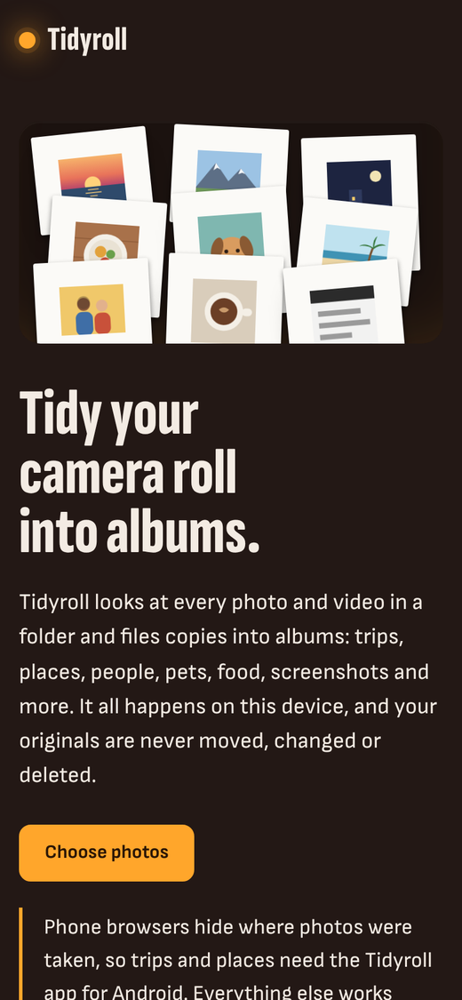

# Tidyroll

**Tidy your camera roll into albums, privately, on your own device.**

Tidyroll looks at every photo and video on your phone or PC and files copies into albums: trips, places, people, pets, food, night shots, screenshots, WhatsApp images, duplicates, blurry shots, plus anything you name, like "dog" or "Italy 2025". Nothing is uploaded, and your original photos are never moved, changed or deleted.

It works on **Windows** (in Chrome or Edge) and **Android** (as an app), from one shared engine.



## See it in action

| Watch your roll develop | Your albums, ready to check |
| --- | --- |
|  |  |

| Open an album to rename it or remove photos | Choose what to make |
| --- | --- |
|  |  |

| Android app | Phone browser |
| --- | --- |
|  |  |

## What it makes

| Group | Albums |
| --- | --- |
| Trips | Every time you were away from home, named by place and month, like "Goa, Dec 2025" |
| Places | One album per country, plus the towns you photograph most |
| People | Portraits and selfies, friends and groups, everyone |
| Things | Pets and animals, food and drinks, nature and mountains, beaches and water, city and architecture, on the move, outfits, at home, desk and tech |
| Moments | Golden hour (using the real sun position), night, big days |
| Your picks | Anything you type: "dog, coffee, sunsets, Italy 2025" |
| Videos | All videos, short clips, long videos |
| Clean-up | Screenshots, WhatsApp, saved from other apps, documents and receipts, duplicates and bursts, blurry shots |

## How to use it

### On Windows

1. Open the Tidyroll website in **Chrome** or **Edge** (or run it yourself, see below).
2. Click **Choose a photo folder** and pick the folder with your photos. To use your phone's photos, connect it with a USB cable, choose **File transfer**, and copy **Internal storage › DCIM › Camera** to your PC first.
3. Choose which albums to make and any special ones, then click **Start sorting**.
4. Check the albums. Rename them, or remove photos that don't belong.
5. Click **Save albums to a folder**. Tidyroll copies the photos into `Sorted Albums › Trips › Goa, Dec 2025` and so on. Changed your mind? **Undo saving** removes exactly those copies.

### On Android

1. Install the app (download the APK from the [Releases](../../releases) page, or from the latest **Android app** run under [Actions](../../actions)).
2. Tap **Open my gallery** and allow access to photos.
3. Choose your albums, tap **Start sorting**, check the result, then tap **Create albums in my gallery**. The albums appear in Samsung Gallery and Google Photos under **Pictures › Sorted Albums**.

## Private by design

- Every photo is analysed on your device by small open models (MobileNetV2 for scenes and objects, YuNet for faces). Faces are found, never identified.
- Places come from built-in map data, so no location ever goes online.
- The Android app has **no internet permission** at all.
- Originals are only read. Albums are copies, and Undo removes them.

## Try the website on your PC now

Browsers only allow folder access on `https` or `localhost`, so open it through a small local server instead of double-clicking `index.html`:

```
npx serve web
```

Then open the address it prints (usually http://localhost:3000) in Chrome or Edge. With Python instead: `python -m http.server 8000 --directory web` and open http://localhost:8000.

To sort photos from an Android phone on Windows: connect the phone by USB, choose **File transfer**, open **Internal storage › DCIM** in File Explorer, copy **Camera** and **Screenshots** into Pictures, then choose that folder in Tidyroll.

## Publish it

### Website on GitHub Pages (free)

1. Create a repository on GitHub and push this whole folder to the `main` branch.
2. In the repository, open **Settings › Pages** and set **Source** to **GitHub Actions**.
3. The **Website** workflow publishes the `web` folder to `https://<your-user>.github.io/<repository>/`.

### Android app

**Easiest: let GitHub build it.** Every push runs the **Android app** workflow. Open **Actions › Android app › latest run** and download **tidyroll-android**: it contains `app-debug.apk`, which installs on any Android 10+ phone (allow "Install unknown apps" for your browser or file manager).

**For public releases**, sign the app with your own key so updates install over older versions:

1. Make a key once (keep the file and passwords safe; you can never replace this key for the same app):
   `keytool -genkeypair -v -keystore tidyroll-release.jks -alias tidyroll -keyalg RSA -keysize 4096 -validity 10000`
2. In the repository, open **Settings › Secrets and variables › Actions** and add `TIDYROLL_KEYSTORE_BASE64` (the .jks file as base64), `TIDYROLL_KEYSTORE_PASSWORD`, `TIDYROLL_KEY_ALIAS` and `TIDYROLL_KEY_PASSWORD`.
3. Push a tag such as `v1.0.0`. The workflow builds the signed APK (to share directly) and an `.aab` bundle (for the Play Store) and attaches the APK to a GitHub release.

**In Android Studio:** open the `android` folder and press Run. The build copies `../web` into the app automatically.

**Google Play:** upload `app-release.aab`. Because Tidyroll reads the whole gallery, the Play Console asks you to fill in the photo and video permissions declaration and explain that organising the gallery is the app's core purpose.

## Before you publish

- **Name.** "Tidyroll" is a working name; check that it is free to use where you publish. Change it in `web/index.html`, `web/manifest.webmanifest` and `android/app/src/main/res/values/strings.xml`.
- **App ID.** Change `applicationId` in `android/app/build.gradle` to your own reverse-domain name (for example `com.yourname.photosorter`). It cannot change after the app is on the Play Store.
- **Licence for your code.** Add a `LICENSE` file of your choice. The bundled models, data, libraries and fonts have their own licences (see `THIRD_PARTY_NOTICES.md`); GeoNames requires the attribution that `web/licenses.html` already shows.

## How it works

| Part | Where |
| --- | --- |
| Screens and flow | `web/js/app.js`, `web/index.html`, `web/css/app.css` |
| Reading folders, files and the Android gallery | `web/js/sources.js` |
| Saving folders, ZIP downloads, gallery albums, Undo | `web/js/output.js` |
| Metadata: EXIF date and GPS, video headers, phone folder names | `web/js/engine/meta.js` |
| Image analysis in parallel workers: MobileNetV2 labels, YuNet faces, colour, sharpness, duplicate hash | `web/js/engine/worker.js`, `vision.js`, `analyzer.js` |
| Countries, towns and time zones, offline | `web/js/engine/geo.js`, `web/data/` |
| Home, trips, categories, golden hour (sun position), duplicates, blur | `web/js/engine/organize.js` |
| Album plan and search | `web/js/engine/planner.js`, `search.js`, `labels.js` |
| Android shell: serves the web app, thumbnails and metadata locally; writes albums with MediaStore | `android/app/src/main/java/app/tidyroll/sorter/` |

The Android app has no internet permission at all. The website downloads its models and map data once (about 22 MB) and then works offline.

## Limits to know about

- **Phone browsers** hide where photos were taken, so trips and places need the Android app. Everything else works in the browser, and albums download as ZIP files.
- **Saving folders from the website** needs Chrome or Edge on a computer. Other browsers can download each album as a ZIP.
- **HEIC photos** (only if "High efficiency pictures" is on in the Samsung camera): on the website their dates and places are used, but the picture itself can't be analysed because Chrome can't decode HEIC. The Android app handles them fully.
- **Recognition is an estimate.** The labels come from a small on-device model. People albums find faces; they do not recognise who someone is.
- **Trip names** use the nearest town of 5,000+ people ("Calangute, Dec 2025"), not states or regions.
- **Copies use space.** The Android app checks free space before it starts and stops with a clear message if there isn't enough.

## If you add a subscription later

- On Android, Google Play Billing handles subscriptions (this needs the Play Store version).
- Anyone can read the website's code, so a paywall there needs a small server that checks a licence key (for example with Lemon Squeezy, Paddle or Stripe). A common pattern is a free website and a paid app.
- Good candidates for paid features: search by description ("sunset with friends") with a CLIP model, grouping photos by person, state and region names for trips, and automatic re-sorting of new photos on Android.
